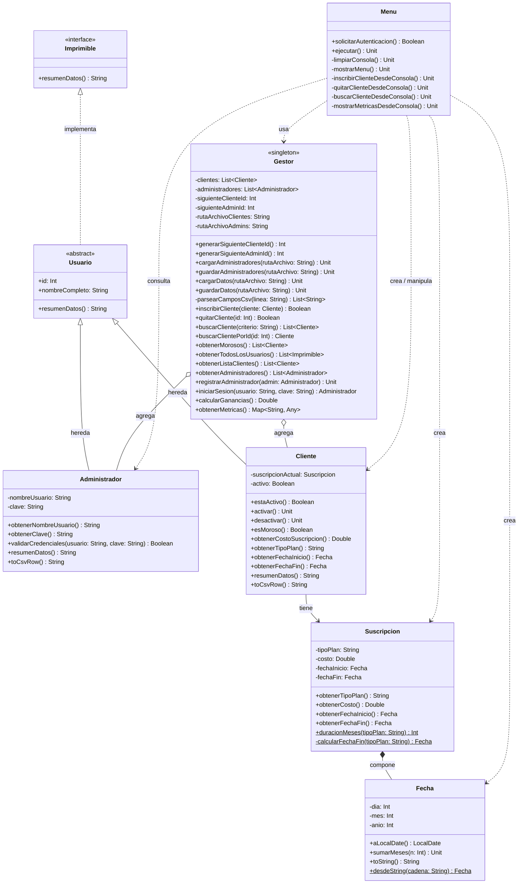

# Sistema de Administración de Gimnasio CLI (`gym-admin-cli`)

[](https://kotlinlang.org/)
[](https://www.oracle.com/java/)
[](LICENSE)
[]()

> Aplicación de consola interactiva (REPL) desarrollada en **Kotlin** para la gestión integral de socios, control de vencimiento de suscripciones, detección de morosos y cálculo financiero de ingresos en un gimnasio.

---

## 📋 Tabla de Contenidos

1. [Problema y Solución](#-problema-y-solución)
2. [Arquitectura y Patrones de Diseño](#-arquitectura-y-patrones-de-diseño)
3. [Modelo de Dominio y Diagrama UML](#-modelo-de-dominio-y-diagrama-uml)
4. [Estructura del Proyecto](#-estructura-del-proyecto)
5. [Persistencia de Datos (CSV)](#-persistencia-de-datos-csv)
6. [Interfaz de Usuario Interactiva (REPL)](#-interfaz-de-usuario-interactiva-repl)
7. [Instrucciones de Instalación y Ejecución](#-instrucciones-de-instalación-y-ejecución)
8. [Principios de POO Aplicados](#-principios-de-poo-aplicados)
9. [Tecnologías y Requisitos](#-tecnologías-y-requisitos)

---

## 🎯 Problema y Solución

### El Problema
Tradicionalmente, la administración de socios y planes en gimnasios medianos o locales se gestiona mediante planillas manuales o libretas físicas. Esto conlleva:
- Imposibilidad de detectar a tiempo a socios con planes vencidos (morosos).
- Errores humanos en el cálculo acumulado de ganancias y cuotas pagadas.
- Lentitud en los procesos de inscripción, baja de clientes y auditoría.
- Pérdida de trazabilidad en los cobros y planes contratados.

### Nuestra Solución
**`gym-admin-cli`** provee una interfaz de línea de comandos (REPL) robusta y de alto rendimiento que:
1. **Carga masiva inicial:** Lee automáticamente más de 200 registros de clientes reales desde un archivo estructurado CSV ([data/usuarios.csv](https://github.com/administrator-11111/gym-admin-cli/blob/master/data/usuarios.csv)).
2. **Evaluación de morosidad en tiempo real:** Compara automáticamente las fechas de finalización de planes contra la fecha del sistema (`LocalDate.now()`).
3. **Control financiero exacto:** Calcula ingresos acumulados totales basados en el costo real de cada suscripción activa.
4. **Operaciones CRUD seguras:** Permite inscribir y remover usuarios garantizando unicidad de identificadores (IDs) y previniendo cierres inesperados por datos inválidos.

---

## 🏛 Arquitectura y Patrones de Diseño

El sistema está diseñado bajo una arquitectura modular desacoplada en tres paquetes principales:
- `com.admincli.core`: Lógica de negocio central y orquestación del estado.
- `com.admincli.modelos`: Entidades del dominio, tipos de datos y relaciones.
- `com.admincli.interfaces`: Contratos polimórficos e interfaz interactiva con el usuario.

### Patrón de Diseño: Singleton (`object Gestor`)

El gestor principal del sistema ([Gestor.kt](file:///c:/Users/return/IdeaProjects/gym-admin-cli/src/main/kotlin/com/admincli/core/Gestor.kt)) implementa el patrón creacional **Singleton** utilizando la construcción nativa `object` de Kotlin.

```
┌────────────────────────────────────────────────────────┐
│                        main()                          │
│     Carga CSV  ──────┐                                 │
└──────────────────────┼─────────────────────────────────┘
                       │
                       ▼
            ┌─────────────────────┐
            │   <<singleton>>     │
            │    Gestor.kt        │◄────── Operaciones REPL
            │  (object Gestor)    │
            └──────────┬──────────┘
                       │
     ┌─────────────────┴─────────────────┐
     ▼                                   ▼
[clientes: MutableList]       [administradores: MutableList]
```

#### ¿Por qué Singleton?
- **Instancia única y centralizada:** Se requiere un único punto de verdad en memoria donde coexistan las colecciones de clientes y administradores.
- **Acceso global desacoplado:** Tanto el punto de entrada [main.kt](https://github.com/administrator-11111/gym-admin-cli/blob/master/src/main/kotlin/com/main.kt) (durante la carga masiva de datos inicial) como el menú interactivo [Menu.kt](https://github.com/administrator-11111/gym-admin-cli/blob/master/src/main/kotlin/com/admincli/interfaces/Menu.kt) (durante la ejecución del usuario) consumen el mismo estado sin necesidad de inyectar o transferir instancias manualmente.
- **Eficiencia e inicialización perezosa (Lazy):** `object` en Kotlin es *thread-safe*, inicializado en su primer acceso y no requiere código repetitivo (*boilerplate*) como constructores privados o métodos estáticos `getInstance()`.

---

## 📊 Modelo de Dominio y Diagrama UML

### Diagrama de Clases (Mermaid)



---

## 📁 Estructura del Proyecto

```
gym-admin-cli/
├── data/
│   └── usuarios.csv                    # Dataset con clientes precargados
├── docs/
│   ├── img/
│   │   └── UML.pdf                 # Diagrama UML renderizado
│   └── uml.mmd                        # Fuente del diagrama de clases en Mermaid
├── src/
│   ├── main/kotlin/com/
│   │   ├── main.kt                    # Punto de entrada (Bootstrapping + REPL)
│   │   └── admincli/
│   │       ├── core/
│   │       │   └── Gestor.kt          # Singleton Gestor: Estado y operaciones
│   │       ├── interfaces/
│   │       │   ├── Imprimible.kt      # Interfaz de polimorfismo de impresión
│   │       │   └── Menu.kt            # Interfaz de consola REPL interactiva
│   │       └── modelos/
│   │           ├── Administrador.kt   # Entidad de personal administrativo
│   │           ├── Cliente.kt         # Entidad de cliente / socio del gimnasio
│   │           ├── Fecha.kt           # Manejo personalizado de fechas
│   │           ├── Suscripcion.kt     # Plan, fechas y costo asociado
│   │           └── Usuario.kt         # Clase abstracta base
├── generador.kt                       # Script generador de datos sintéticos
├── README.md                          # Documentación oficial
├── LICENSE                            # Licencia MIT
└── .gitignore
```

---

## 💾 Persistencia de Datos (CSV)

El sistema carga de manera predeterminada los datos desde `data/usuarios.csv`.

### Estructura de Columnas
```csv
Id,Nombre Completo,Suscripcion,Costo,FechaInicio,FechaFin
1,"Juan Pérez",Mensual,20000.0,01/10/2026,01/11/2026
2,"María González",Trimestral,50000.0,15/07/2026,15/10/2026
...
```

### Parser Robusto con Soporte para Comillas
A diferencia de un `split(",")` tradicional que rompe nombres compuestos con comas (como `"Pérez, Juan"`), [Gestor.kt](https://github.com/administrator-11111/gym-admin-cli/blob/master/src/main/kotlin/com/admincli/core/Gestor.kt) implementa un analizador caracter por caracter con bandera de estado (`dentroComillas`):
- Respeta los textos delimitados por comillas dobles.
- Tolera líneas malformadas o campos faltantes mediante control de excepciones `try-catch`, asegurando que un registro defectuoso no interrumpa la carga de los demás.

---

## 🖥 Interfaz de Usuario Interactiva (REPL)

Al ejecutar la aplicación, el usuario interactúa a través de un bucle de consola (*Read-Eval-Print Loop*):

```text
Sistema de Administración de Gimnasio
Cargando datos iniciales...
Se cargaron 200 clientes desde data/usuarios.csv

[1] ver lista de usuarios
[2] inscribir usuarios
[3] quitar usuarios
[4] revisar usuarios morosos
[5] ver ganancias
[6] salir del sistema
Opcion>> 
```

### Detalle de Operaciones

| Opción | Acción | Descripción Técnica |
|:---:|---|---|
| **[1]** | **Ver lista de usuarios** | Invoca `Gestor.listarClientes()` o `Gestor.listarTodosLosUsuarios()`. Muestra polimórficamente cada usuario registrado con su ID, nombre, plan y fecha de término. |
| **[2]** | **Inscribir usuarios** | Solicita ID, nombre, plan (Mensual/Trimestral/Anual), costo y fecha de inicio. Calcula la fecha de término (`sumarMeses`) y verifica que el ID no esté duplicado antes de agregarlo. |
| **[3]** | **Quitar usuarios** | Solicita el ID del cliente a dar de baja. Busca en la lista por predicado `find { it.id == id }` y confirma su eliminación. |
| **[4]** | **Revisar morosos** | Filtra clientes cuya fecha de fin sea anterior a la actual (`esMoroso() == true`). |
| **[5]** | **Ver ganancias** | Suma acumulativa de los costos de suscripción de todos los clientes registrados. |
| **[6]** | **Salir del sistema** | Termina el ciclo del REPL de forma limpia. |

---

## 🚀 Instrucciones de Instalación y Ejecución

### Prerrequisitos
- **Java Development Kit (JDK):** Versión 17 o superior.
- **Kotlin Compiler (`kotlinc`):** Versión 2.0+ (o IntelliJ IDEA con plugin de Kotlin integrado).

### Opción A: Ejecución desde IntelliJ IDEA (Recomendado)
1. Abrir **IntelliJ IDEA**.
2. Seleccionar **File** -> **Open...** y elegir la carpeta raíz `gym-admin-cli`.
3. Esperar que el IDE indexe el proyecto.
4. Navegar a `src/main/kotlin/com/main.kt`.
5. Hacer clic en el ícono verde de **Play** al lado de la función `fun main()`.

### Opción B: Compilación y Ejecución por Consola
Abrir una terminal (PowerShell o Bash) en la raíz del proyecto:

```powershell
# 1. Compilar todos los archivos fuente a un archivo JAR
kotlinc src/main/kotlin/com/admincli/interfaces/*.kt src/main/kotlin/com/admincli/modelos/*.kt src/main/kotlin/com/admincli/core/*.kt src/main/kotlin/com/main.kt -include-runtime -d gym-admin.jar

# 2. Ejecutar la aplicación
java -jar gym-admin.jar

# ----------------
# 1. Opción 2:
kotlinc src\main\kotlin -include-runtime -d app.jar
java -jar app.jar
```
---
## 🧩 Principios de POO Aplicados

| Principio | Dónde se aplica en el proyecto |
|---|---|
| **Abstracción** | Clase abstracta `Usuario` e interfaz `Imprimible`, abstrayendo la identidad del usuario y la capacidad de reportar datos. |
| **Encapsulamiento** | Atributos privados (`private val/var`) en todas las clases (`Cliente`, `Administrador`, `Suscripcion`, `Fecha`, `Gestor`), accesibles solo por métodos explícitos. |
| **Herencia** | `Cliente` y `Administrador` extienden a `Usuario`, reutilizando identificador y nombre completo. |
| **Polimorfismo** | Override de `resumenDatos()` en `Cliente` y `Administrador`, permitiendo que una lista de tipo `List<Imprimible>` imprima el formato adecuado para cada entidad. |
| **Composición** | `Suscripcion` compone fuertemente objetos `Fecha` para definir su vigencia. |
| **Agregación** | `Gestor` agrega colecciones de `Cliente` y `Administrador`, gestionando su ciclo de vida independientemente. |

---

## 🛠 Tecnologías y Requisitos

- **Lenguaje:** Kotlin 2.x
- **Plataforma de Ejecución:** JVM (Java Virtual Machine) 17+
- **Control de Versiones:** Git (Flujo de commits convencionales)
- **Bibliotecas:** Biblioteca estándar de Kotlin y JDK (`java.time.LocalDate`, `java.io.File`). **Sin dependencias externas pesadas ni frameworks de terceros.**

---

## 📄 Licencia

Este proyecto está bajo la Licencia **MIT** — ver el archivo [LICENSE](file:///c:/Users/return/IdeaProjects/gym-admin-cli/LICENSE) para más detalles.
---
## Declaración del uso de IA
```
Nota: Se utilizaron herramientas de IA en el diseño de este material.
```
